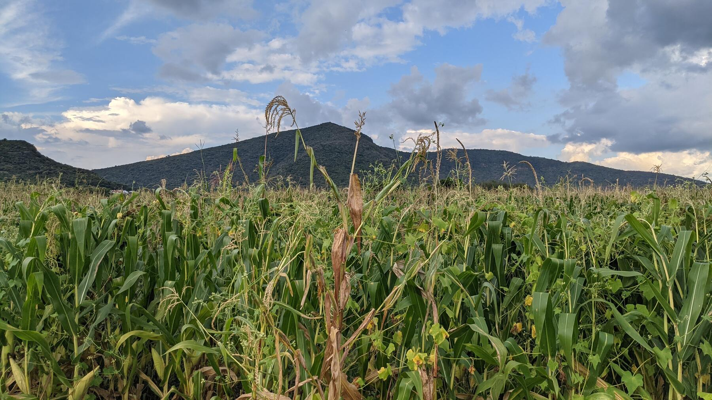

```{=html}
<div class="home-banner">
  
</div>
```

# **G**enetics, **E**volution and **M**etabolism of **M**aize **A**daptation Lab  

<br>

<!-- Contact Information -->

::: text-center
<p><b>We are at North Carolina State University, Department of Structural and Molecular Biochemistry.</b></p>

<p>📍 <b>Location:</b> Plant Sciences Building, 840 Oval Dr, Raleigh, NC 27606<br>
Room 3122 (Office), Room 3110 (Shared open space), Room 3105 (Shared wet lab)</p>

<p>📧 <b>Email:</b> <a href="mailto:rrellan@ncsu.edu">rrellan\@ncsu.edu</a> \| 📞 <b>Phone:</b> (919) 344-9184</p>
:::

<br>

<!-- Join -->

::: {.home-join .text-center}
<p style="font-size: 21px;">

<b>Interested in joining our lab?</b>

</p>

<p>Explore our <a href="research.html">current research areas</a> for potential projects.</p>

<p>Learn about our <a href="expectations.html">lab philosophy</a> and expectations.</p>
:::

<!-- Images  -->


