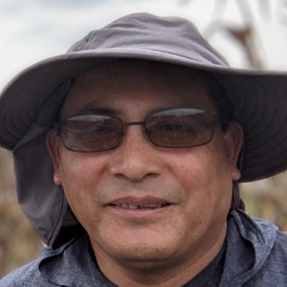
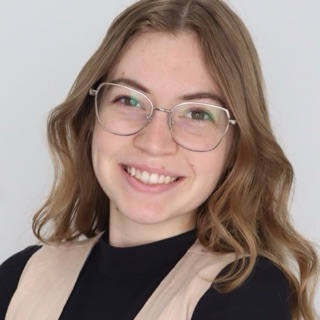
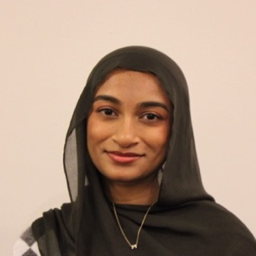
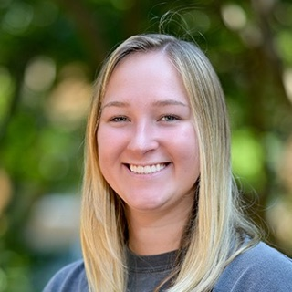
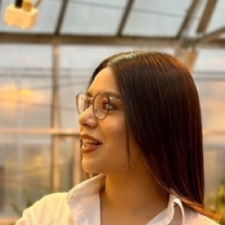
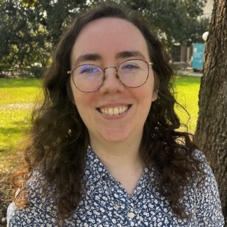
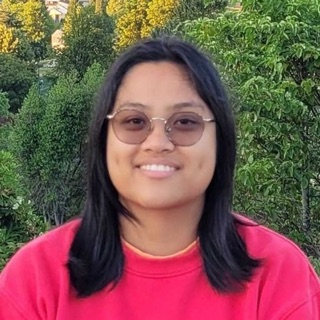
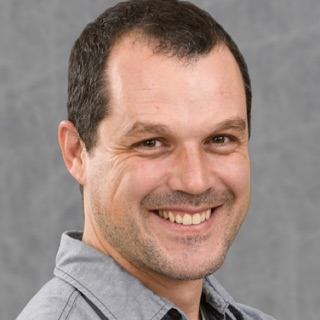
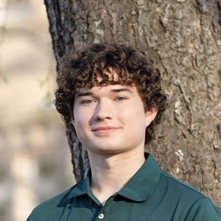

::: {.home-section .home-hero}
# We map the wild alleles that helped maize adapt, and put them to work in modern maize.

The Genetics, Evolution and Metabolism of Maize Adaptation Lab combines quantitative
and population genetics, lipidomics and gene editing to study cold tolerance and
nitrogen and phosphorus efficiency.
:::

::: {.home-section}
::: {#genome-panel .genome-panel aria-label="Research stories in the maize genome" role="region"}
::: {.gp-fallback}
Our research stories are drawn on the maize genome here when JavaScript is on.
You can also read about them on the [Research page](research.qmd).
:::
:::
:::

::: {.home-section}
## Research tracks

::: {.tracks}
::: {.track}
[Local adaptation]{.track-name}

How teosinte *mexicana* introgressions such as *Inv4m* and the phospholipase *HPC1*
changed flowering time and lipid metabolism in highland maize.
:::

::: {.track}
[Nitrogen and N₂O]{.track-name}

NSave Maize, with ARPA-E: nitrification-suppressing and nitrogen-recycling alleles
from wild relatives, to cut nitrous oxide emissions.
:::

::: {.track}
[Cold tolerance]{.track-name}

CERCA: highland alleles lost during domestication, like those in Palomero Toluqueño,
so maize can be planted earlier.
:::

::: {.track}
[Phosphorus]{.track-name}

With the NSF STEPS center: phosphorus use efficiency in maize and sorghum, and gene
edits that lower phytate in the grain.
:::

::: {.track}
[Lipidomics]{.track-name}

Population-scale lipid profiles of maize and sorghum, open as the
[Sorghum Lipid Database](https://nirwan.shinyapps.io/SAP-Lipidomics-Database/) and the
*Zea Lip* leaf atlas.
:::

::: {.track}
[Teosinte introgressions]{.track-name}

ZeaL, the Zea Exotic Allele Library: 82 teosinte accessions crossed into B73, plus
2,208 near-isogenic lines in CML311, to find wild alleles worth keeping.
:::
:::

[More about our research](research.qmd){.more-link}
:::

::: {.home-section .home-split}
::: {.home-col}
## Publications



[Full publication list](publications.qmd){.more-link}
:::

::: {.home-col}

:::
:::

::: {.home-section .home-split}
::: {.home-col}
## People

<!-- One row per current member, sorted by surname. Headshots: images/people/. -->

| Name | Role |
|------|------|
| [{.person-thumb} Pascual Blanco]{.person-cell} | Field technician |
| [{.person-thumb} Brock Davis]{.person-cell} | Undergraduate researcher |
| [{.person-thumb} Zehta Fazler]{.person-cell} | PhD student |
| [{.person-thumb} Maheera Hassan]{.person-cell} | Undergraduate researcher |
| [{.person-thumb} Lauren Insko]{.person-cell} | PhD student |
| [{.person-thumb} Sanaa Jain]{.person-cell} | Undergraduate researcher |
| [{.person-thumb} Lina López-Corona]{.person-cell} | Project manager, ARPA-E NSave Maize |
| [{.person-thumb} Jill Love]{.person-cell} | Postdoc |
| [{.person-thumb} Hannah Pil]{.person-cell} | PhD candidate |
| [{.person-thumb} Rubén Rellán-Álvarez]{.person-cell} | Principal investigator |
| [{.person-thumb} Fausto Rodríguez-Zapata]{.person-cell} | Postdoc |
| [{.person-thumb} Sam Strimple]{.person-cell} | Undergraduate researcher |
| [{.person-thumb} Nirwan Tandukar]{.person-cell} | Postdoc |
: {.people-table}

[Profiles and former members](people.qmd){.more-link}
:::

::: {.home-col .home-col-narrow}
## News



[All news](news.qmd){.more-link}
:::
:::

::: {.home-section}
::: {.join-box}
::: {.join-text}
## Interested in joining?

Read about our research areas and how we work together, then write to Rubén with what
you would like to study.
:::

::: {.join-actions}
[Lab philosophy](expectations.qmd){.btn-solid}
[Email Rubén](mailto:rrellan@ncsu.edu){.btn-outline}
:::
:::
:::
