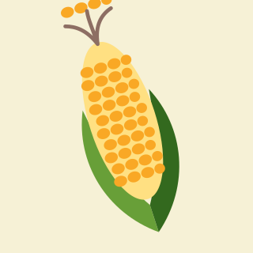

---

```{r crew, echo=FALSE, results='asis', warning=FALSE, message=FALSE}
# Builds the people cards from people.yml (see the comments in that file).
people <- yaml::yaml.load(paste(readLines("people.yml", encoding = "UTF-8", warn = FALSE), collapse = "\n"))

slug <- function(x) if (is.null(x)) "" else gsub("[^a-z0-9]+", "-", tolower(x))

card <- function(p) {
  photo <- if (!is.null(p$photo) && file.exists(p$photo)) {
    sprintf('', p$photo, p$name)
  } else {
    ''
  }
  links <- ""
  if (length(p$links)) {
    links <- paste0('<p class="person-links">', paste(vapply(p$links, function(l)
      sprintf('<a href="%s" aria-label="%s"><i class="fa %s" aria-hidden="true"></i></a>',
              l$url, l$label, l$icon), ""), collapse = " "), "</p>")
  }
  # data-group and data-themes are what the filters above the grid select on
  attrs <- sprintf(' data-group="%s" data-themes="%s"', slug(p$group), paste(unlist(p$themes), collapse = " "))
  paste0("::: {.person-card", attrs, "}\n", photo, "\n\n",
         '<p class="person-name">', p$name, "</p>\n\n",
         "[", p$role, "]{.person-role}\n\n",
         if (!is.null(p$bio)) paste0(p$bio, "\n\n") else "",
         links, "\n:::\n\n")
}

# Filters above the grid, by role (group in people.yml) and by research theme (themes, with the
# labels and colours of research_map.yml). assets/people-filter.js builds the buttons.
groups <- c("Principal investigator" = "PI", "Postdocs" = "Postdocs",
            "Graduate students" = "Graduate students",
            "Undergraduate researchers" = "Undergraduates", "Staff" = "Staff")
themes <- yaml::read_yaml("research_map.yml")$themes
filter_data <- list(
  groups = unname(Map(function(g, label) list(id = slug(g), label = label), names(groups), groups)),
  themes = lapply(themes, function(x) list(id = x$id, label = x$label, color = x$color)))
cat("```{=html}\n",
    '<link rel="stylesheet" href="assets/people-filter.css">\n',
    '<div id="people-filter"></div>\n',
    '<script type="application/json" id="people-filter-data">',
    jsonlite::toJSON(filter_data, auto_unbox = TRUE), "</script>\n",
    '<script src="assets/people-filter.js"></script>\n',
    "```\n\n", sep = "")

# Everyone in one grid, in alphabetical order by first name (accents ignored).
names <- vapply(people$current, function(p) p$name, "")
cat(":::: {.people-grid}\n")
for (p in people$current[order(tolower(iconv(names, "UTF-8", "ASCII//TRANSLIT")))]) cat(card(p))
cat("::::\n\n")

cat("### **Former lab members**\n\n::: {.former-list}\n")
for (p in people$former) cat("- **", p$name, "** ", p$role, "\n", sep = "")
cat(":::\n")
```
