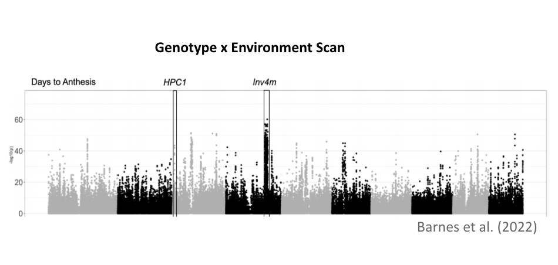
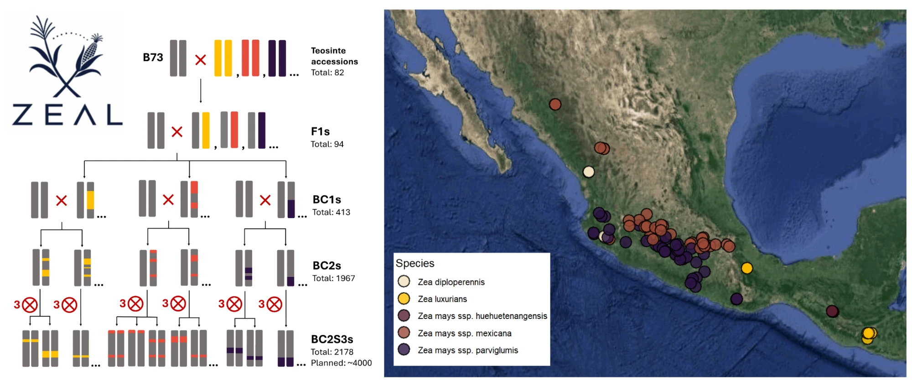

---


We are broadly interested in understanding the metabolic and morphological mechanisms that plants have developed to adapt to soils with low nutrient availability. Our work follows the lab's name, **G**enetics, **E**volution and **M**etabolism of **M**aize **A**daptation, and falls into the four themes below. 

```{r research-map, echo=FALSE, results='asis', warning=FALSE, message=FALSE}
# Builds the research map from research_map.yml (see the comments in that file).
research_map <- yaml::yaml.load(paste(readLines("research_map.yml", encoding = "UTF-8", warn = FALSE), collapse = "\n"))
cat("```{=html}\n",
    '<link rel="stylesheet" href="assets/research-map.css">\n',
    '<div id="research-map"></div>\n',
    '<script type="application/json" id="research-map-data">',
    jsonlite::toJSON(research_map, auto_unbox = TRUE),
    "</script>\n",
    '<script src="assets/research-map.js"></script>\n',
    "```\n", sep = "")
```

### Finding adaptive genes and predicting performance {#genes-prediction}

Finding the genes behind a trait is hard when many genes each contribute a little. We develop statistical methods that combine several kinds of evidence, such as genome-wide association studies of metabolite levels and genetic differentiation among geolocated natural populations, to rank candidate genes and metabolic pathways. We are applying them to study how phosphorus deficiency and cold change lipid metabolism in sorghum, and they can be extended to bioenergy crops and other stresses.

We also use machine learning to predict how maize and sorghum genotypes will perform in different environments and to guide breeding. Combining genomic data from landraces with soil nitrogen and phosphorus data, we model the adaptive potential of untested genotypes and the nutrient conditions that suit each genetic background, which helps us choose mapping populations for field trials. With transfer learning, models trained on metabolomic and lipidomic data from one species are fine-tuned for the other, taking advantage of the biochemistry and regulation that maize and sorghum share.

### Teosinte alleles behind highland adaptation {#highland-alleles}

Maize was domesticated from teosinte *parviglumis* in southwest Mexico about 9,000 years ago and later spread into the cool, dry highlands of central Mexico, home of the wild teosinte *mexicana*. Using genome scans of Mexican traditional varieties and linkage mapping in controlled crosses, we identified two regions that highland maize inherited from *mexicana*: the phospholipase gene *HPC1* and the chromosomal inversion *Inv4m*. Both affect flowering time, and their effects depend on the environment. *HPC1* appears to act through phospholipid metabolism, while *Inv4m* may speed up flowering through a gene network that controls cell proliferation and the shoot apical meristem's transition to flowering. Together they show how *mexicana* alleles could improve stress tolerance and reproductive fitness. Our work on *Inv4m* is a collaboration with the lab of Ruairidh Sawers.

<div style="text-align: center;">
  
</div>

Read more: [*HPC1*](https://doi.org/10.1073/pnas.2100036119) (*PNAS*, 2022) and [*Inv4m*](https://doi.org/10.64898/2026.06.16.732082) (preprint, 2026).

### Wild allele libraries: ZeaL and CML311 lines {#wild-alleles}

Teosinte, the wild ancestor of maize, carries useful alleles that were largely lost during domestication, but its photoperiod response and growth habit make it hard to evaluate in the field. We move teosinte alleles into maize backgrounds so they can be tested directly.

{width="100%"}

**ZeaL.** The Zea Exotic Allele Library crosses 82 georeferenced accessions of five teosinte taxa, collected across Mexico and Central America, into the temperate inbred line B73. Backcrossing twice to B73 and then selfing gives BC~2~S~3~ lines that each carry about 12.5% of a teosinte genome and can be grown in temperate fields. The library has 2,178 lines, with about 4,000 planned. ZeaL is a collaboration with the labs of James Holland, Jesús Sánchez, Ruairidh Sawers, Edward Buckler and Matthew Hufford. We are using it to explore nutrient-efficiency traits in wild relatives of maize. We expect the perennial teosinte *Zea diploperennis* to carry nutrient-recycling alleles that could make maize more nitrogen efficient, so we grow ZeaL lines derived from it with and without enough nitrogen and measure their nitrogen content with hyperspectral reflectance, a fast, nondestructive method.

**CML311 introgression lines.** We are also characterizing 2,208 near-isogenic lines from crosses between the elite tropical line CML311 and 85 teosinte plants, sampled from 78 wild populations that span nearly all *Zea* taxa. The introgressions were mapped by sequencing, and trials in three Mexican environments tested whether QTLs are consistent across teosinte donors.

### Membrane lipid remodeling in maize and sorghum {#lipid-remodeling}

Plants remodel the glycerolipids in their membranes to cope with stress. In the cold they add phospholipids to keep membranes fluid, and when phosphorus is scarce they recycle phospholipids and replace them with galactolipids and sulfolipids. Highland maize faces both challenges, low temperatures and volcanic soils with little available phosphorus, in Mexico and again in the Andes, which makes it an ideal model for studying local and convergent adaptation. We think its glycerolipid metabolism was under strong selection in the highlands, and we map the loci behind lipid remodeling in populations grown in highland and lowland fields.

**A highland phospholipase.** *HPC1* (*High PhosphatidylCholine 1*), introgressed from teosinte *mexicana*, encodes a phospholipase A1 that cleaves phosphatidylcholine (PC) into lysophosphatidylcholine (LPC). PC helps keep membranes stable, while high levels of LPC can damage cells in the cold. In highland maize, a mutation in the flap lid, the part of the enzyme that covers its catalytic triad and helps bind the substrate, disrupts the enzyme. The enzyme's structure has been predicted but not yet solved experimentally; we are characterizing it to learn how *HPC1* could be selected or modified to make maize more adaptive.

**Sorghum lipidomics.** We profiled the lipids of the 400-genotype Sorghum Association Panel under control conditions and under low phosphorus, low nitrogen and cold. We identified stress-responsive lipids, ran a genome-wide association study for each one, and are now validating candidate genes for tolerance to multiple stresses. You can explore the data in the [Sorghum Lipid Database (SoLD)](https://nirwan.shinyapps.io/SAP-Lipidomics-Database/).

Read more: [*HPC1*](https://doi.org/10.1073/pnas.2100036119) (*PNAS*, 2022), [*Zea Lip*, an atlas of maize leaf glycerolipids](https://doi.org/10.64898/2026.05.07.723536) (preprint, 2026) and [SoLD](https://doi.org/10.64898/2026.06.05.727974) (preprint, 2026).

### Nitrogen and phosphorus efficiency {#nutrient-efficiency}

Maize and sorghum need large amounts of nitrogen and phosphorus fertilizer, and the excess pollutes water, degrades soil and adds to greenhouse gas emissions. We study how crops take up, move and use these nutrients, so they can produce high yields with less fertilizer.

**NSave Maize.** In NSave (N~2~O Suppression and Ammonium aVailability Enhancement), the University of Illinois Urbana-Champaign, NC State, the University of Arizona and Oak Ridge National Laboratory are combining traits from wild and modern maize to cut nitrous oxide emissions by 50% and fertilizer use by 55% while keeping yields high. Field trials and modeling will measure the economic and environmental impact, and industry partners will help bring NSave maize to farmers.

**Less nitrogen and phosphorus in the grain.** Much of the nitrogen and phosphorus a crop takes up goes into the grain and leaves the field at harvest. We aim to lower the nitrogen and phosphorus content of maize and sorghum grain so crops depend less on fertilizer, and with population genetics and genome-wide association studies we have found alleles and genes that control nutrient uptake, transport and use. Most grain phosphorus is stored as phytate, which people cannot digest; it is excreted and contributes to the eutrophication of lakes and rivers. We are using CRISPR-Cas9 to knock out genes involved in phosphorus accumulation in the grain while keeping maize productive.

### Cold tolerance for earlier planting {#cold-tolerance}

Planting maize earlier in spring can improve nitrogen uptake and reduce emissions, but it exposes young plants to cold that limits growth and yield. Highland landraces from Mexico, such as Palomero Toluqueño, carry unique alleles that modern maize has lost, which may be key to improving its cold tolerance. We are measuring cold-stress responses and gene expression in recombinant inbred lines from a cross between Palomero Toluqueño and a commercial line, to find the alleles and pathways that would let maize be planted earlier and cope with a changing climate.

<div style="text-align: center;">
  
</div>

Read more: [Designing a nitrogen-efficient cold-tolerant maize for modern agricultural systems](https://doi.org/10.1093/plcell/koaf139) (*The Plant Cell*, 2025).

### Get in touch {#contact}

Have questions or want to know more? Reach out to [Dr. Rellán-Álvarez](mailto:rrellan@ncsu.edu) and use 'Supercalifragilisticexpialidocious' as the code word in the subject line!
